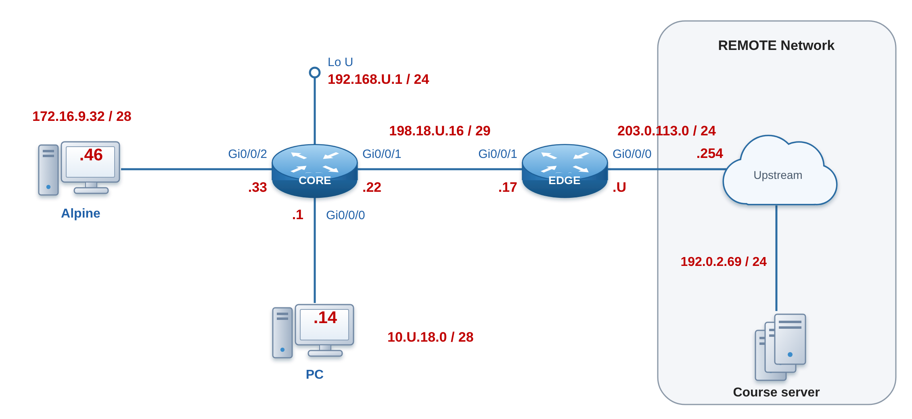

# Lab 10: NAT Foundations (PAT, Static Port-Forwarding, and Dynamic Pools)

## 📌 Project Overview
This project demonstrates the configuration, verification, and engineering implementation of IPv4 Network Address Translation (NAT) and Port Address Translation (PAT) on a Cisco IOS-XE enterprise border gateway router. The deployment establishes secure boundary parameters to conserve public IPv4 space while exposing targeted internal services securely.

## 🛠️ Network Topology & Architecture
This topology leverages a two-router core architecture deploying OSPF routing across private subnets, bounded by a hardened perimeter gateway managing translation tables.



- **EDGE Router:** Core perimeter border gateway managing NAT translations, access control policies, and upstream ISP transit.
- **CORE Router:** Internal routing plane distributing connectivity across enterprise local subnets via OSPF Area 0.
- **Internal LAN Networks (Pod 12 Specifics):** 
  - **Alpine Production Subnet:** `172.16.9.32/28` (Host IP: `172.16.9.46`)
  - **Management PC Subnet:** `10.12.18.0/28` (Host IP: `10.12.18.14`)
  - **CORE-EDGE Transit Subnet:** `198.18.12.16/29`
  - **Public NAT Pool Block:** `209.10.12.2` to `209.10.12.6`

---

## 💻 Router Deployments & Configurations

### 🛡️ EDGE (Border NAT Gateway Router — Pod 12)
Below is the verified implementation applied to the perimeter router to enforce translation policies:

```text
interface GigabitEthernet0/0/1
 description Inside interface, OSPF neighbor to CORE
 ip nat inside

interface GigabitEthernet0/0/0
 description Outside interface to Internet
 ip nat outside

! --- NAT Rule #1: PAT Overload to Exit Interface ---
access-list 16 permit 172.16.9.32 0.0.0.15
ip nat inside source list 16 interface GigabitEthernet0/0/0 overload

! --- NAT Rule #2: Static Inbound Port-Forwarding ---
ip nat inside source static tcp 172.16.9.33 23 interface GigabitEthernet0/0/0 2323

! --- NAT Rule #3: Dynamic Address Translation Pools ---
access-list 18 permit 10.12.18.0 0.0.0.15
ip nat pool NAT_POOL 209.10.12.2 209.10.12.6 netmask 255.255.255.248
ip nat inside source list 18 pool NAT_POOL overload
```

### 🛣️ CORE (Internal Distribution Router — Pod 12)
The routing distribution profile running on the internal core network infrastructure:

```text
interface GigabitEthernet0/0/0
 description Inside gateway for dynamic NAT pool hosts
 ip address 10.12.18.1 255.255.255.240

interface GigabitEthernet0/0/1
 description OSPF neighbour to EDGE
 ip address 198.18.12.22 255.255.255.248

interface GigabitEthernet0/0/2
 description Host receiving static port-forward (Telnet)
 ip address 172.16.9.33 255.255.255.240

```

---

## 🔬 Operational Verification
The following diagnostic commands were executed on live hardware to confirm translation state retention and hit counters:
- `show ip nat translations` — Evaluates active translation states, mapping global addresses to internal local identities.
- `show ip nat statistics` — Authoritative validation metric verifying active pools, perimeter boundary orientation, and dynamic entry counts.
- `show tcp brief` — Confirms socket state transitions and transport layer connections across boundary devices.

---

