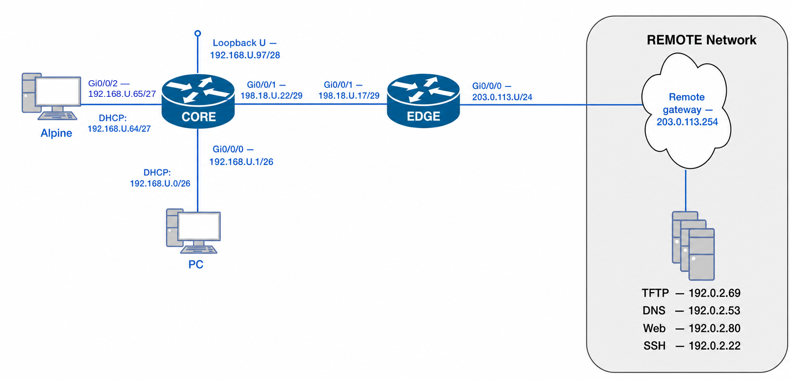

# Lab 12: OSPF, NAT, and Extended ACLs — Full-Stack Policy on a Routed Edge

## Overview
This lab implements a complete, multi-layer enterprise edge architecture on Cisco IOS-XE routers (`EDGE` and `CORE`). Starting from a VLSM-addressed baseline, the build layers single-area **OSPF** routing, **PAT (NAT Overload)** using a summarized wildcard selector, and three strategically placed **Named Extended ACLs** (`POLICY-VM`, `POLICY-PC`, and `POLICY-EXTERNAL`) to enforce host, subnet, and control-plane security policies.

---

## Topology & VLSM Addressing Plan

All internal networks are carved via VLSM from a single `/24` block (`192.168.12.0/24`):

| Network Segment | Subnet / CIDR | Subnet Mask | Wildcard Mask | Gateway / Interface |
| :--- | :--- | :--- | :--- | :--- |
| **PC LAN** | `192.168.12.0/26` | `255.255.255.192` | `0.0.0.63` | `CORE Gi0/0/0` (`192.168.12.1`) |
| **Server / VM LAN** | `192.168.12.64/27` | `255.255.255.224` | `0.0.0.31` | `CORE Gi0/0/2` (`192.168.12.65`) |
| **Loopback Network** | `192.168.12.96/28` | `255.255.255.240` | `0.0.0.15` | `CORE Loopback12` (`192.168.12.97`) |
| **Transit Link** | `198.18.12.16/29` | `255.255.255.248` | `0.0.0.7` | `EDGE Gi0/0/1` (`.17`) ↔ `CORE Gi0/0/1` (`.22`) |
| **Outside / WAN** | `203.0.113.0/24` | `255.255.255.0` | `0.0.0.255` | `EDGE Gi0/0/0` (`203.0.113.12`) → `203.0.113.254` |
| **NAT Public Pool** | `209.10.12.0/28` | `255.255.255.240` | — | First 6 usable IPs (`209.10.12.1` – `209.10.12.6`) |

---

## Implementation Summary

### 1. Single-Area OSPF Routing (`Process 12`, `Area 0`)
* **Manual Router-IDs:** Configured `12.0.0.17` on `EDGE` and `12.0.0.22` on `CORE`.
* **Reference Bandwidth:** Set `auto-cost reference-bandwidth 10000` (10 Gbps) on both routers for accurate Gigabit metric calculation.
* **DR Election & Timers:** Configured `ip ospf priority 12` on `EDGE Gi0/0/1` to win the Designated Router (DR) role, `ip ospf priority 0` on `CORE` LAN interfaces, and tuned transit timers to `hello 5` / `dead 20`.
* **Default Route & Security:** Originated the upstream static default route into OSPF from `EDGE` (`default-information originate`), kept `EDGE Gi0/0/0` completely excluded from OSPF, set all non-transit interfaces to `passive-interface`, and configured `ip ospf network point-to-point` on `CORE Loopback12` to advertise its true `/28` prefix.

### 2. Dynamic PAT (NAT Overload) Policy on `EDGE`
A single summarized NAT policy on `EDGE` translates outbound traffic from all three internal VLSM subnets into a public address pool while isolating `CORE` from any NAT state:

| Policy Parameter | Configured Value | Architectural Purpose |
| :--- | :--- | :--- |
| **Translation Type** | Dynamic PAT (`overload`) | Multiplexes concurrent TCP, UDP, and ICMP sessions across shared pool IPs using unique source ports. |
| **Selector ACL (`ACL 12`)** | `permit 192.168.12.0 0.0.0.255` | Single summarized ACE covering PC (`/26`), Server/VM (`/27`), and Loopback (`/28`) sub-blocks simultaneously. |
| **Public NAT Pool** | `209.10.12.1` – `209.10.12.6` (`/28`) | Allocates the first 6 usable host addresses of `209.10.12.0/28` (`netmask 255.255.255.240`), excluding network/broadcast IPs. |
| **Inside Boundary** | `EDGE Gi0/0/1` (`ip nat inside`) | Identifies traffic arriving from `CORE` (`198.18.12.16/29` and internal VLSM subnets) eligible for translation. |
| **Outside Boundary** | `EDGE Gi0/0/0` (`ip nat outside`) | Identifies the upstream WAN interface (`203.0.113.12`) where private source addresses are translated before routing to `REMOTE`. |
| **Verified Flows** | HTTP, HTTPS, TFTP, SSH, DNS, ICMP | Confirmed bidirectional translation for both PC and Server/VM subnets prior to applying ACL restrictions. |

### 3. Extended Access Control Lists (Traffic Filtering)

| ACL Name | Placement | Direction | Policy Enforced |
| :--- | :--- | :--- | :--- |
| **`POLICY-VM`** | `CORE Gi0/0/2` | `in` | Blocks Server/VM subnet (`192.168.12.64/27`) from HTTP (`80`), HTTPS (`443`), TFTP (`69`), SSH (`22`) to external servers, and ICMP `echo` requests to the PC subnet (`192.168.12.0/26`). Permits all other traffic. |
| **`POLICY-PC`** | `CORE Gi0/0/0` | `in` | Blocks DNS (`UDP/53`) from the specific PC host to `192.0.2.53`, HTTP (`TCP/80`) from the PC subnet to `192.0.2.69`, and HTTPS (`TCP/443`) to `192.0.2.80`. Permits TFTP, SSH, and HTTP to `192.0.2.80`. |
| **`POLICY-EXTERNAL`** | `EDGE Gi0/0/0` | `in` | Protects `EDGE`'s control plane (`203.0.113.12`) by blocking inbound external SSH (`TCP/22`) and ICMP `echo` requests (Type 8), while permitting ICMP `echo-reply` (Type 0) and return NAT traffic. |

---

## Key Architecture & Troubleshooting Takeaways
* **Extended ACL Placement:** Outbound user/server restrictions (`POLICY-VM` and `POLICY-PC`) are placed **inbound on the closest inside interface** to drop unwanted packets before routing or NAT occurs. Control-plane protection (`POLICY-EXTERNAL`) is placed **inbound on the outside interface** closest to the target.
* **Order of Operations (Inside vs. Outside):** Inbound ACLs on inside interfaces evaluate **pre-NAT private IP addresses**, whereas inbound ACLs on the outside interface evaluate **post-NAT / pre-untranslation public pool addresses**.
* **Stateful Ping Filtering (`echo` vs. `echo-reply`):** Specifying `echo` on inbound external ICMP rules blocks external ping probes (Type 8) without breaking return replies (Type 0) for pings initiated from inside the network.
