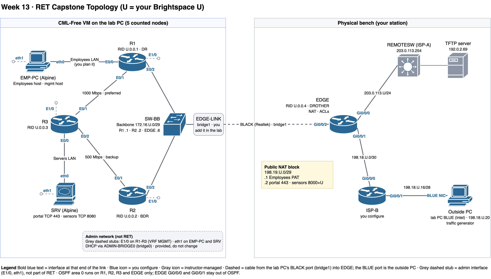
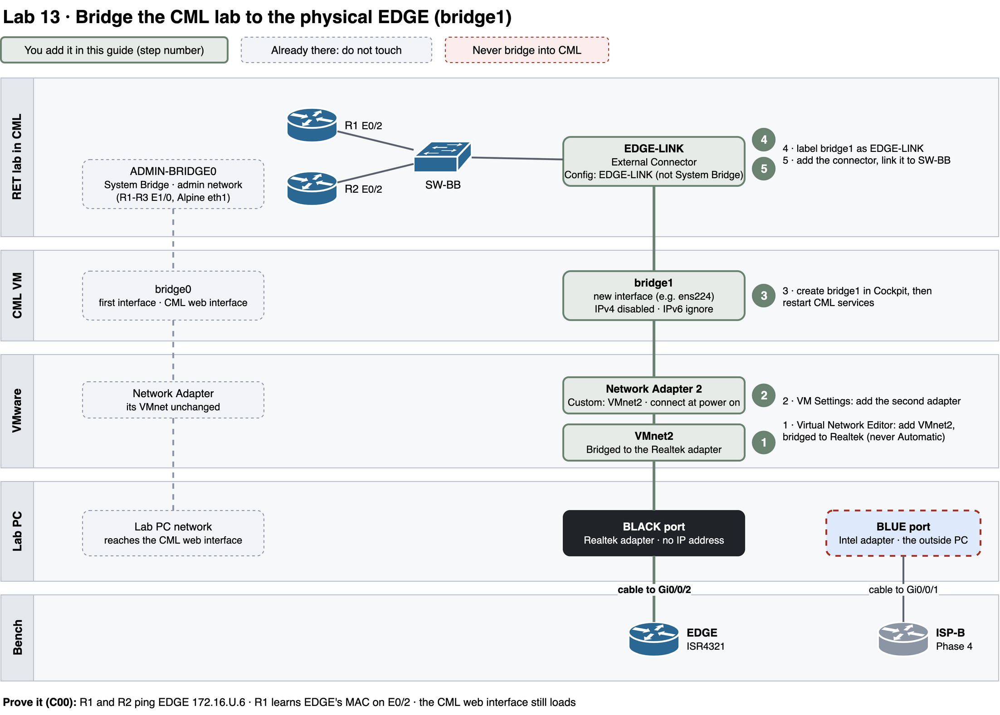

# Lab 13 — RET Capstone: Enterprise Dual-ISP Edge, OSPF, NAT & Security

## Overview
Designed and implemented a hybrid virtual/physical enterprise network for **Rideau Environmental Technologies (RET)** using **Cisco Modeling Labs (IOL-XE)** and physical **Cisco IOS-XE** routers. Working from architectural requirements, the network connects headquarters to two ISPs, publishes external customer and IoT sensor services, and enforces layered internal and perimeter security policies.

---

## Network Topology





---

## Key Implementations
* **VLSM Addressing (`10.<U>.0.0/23`):** Carved binary-aligned subnets for Employees (`/24`, 254 hosts), Servers (`/27`, 30 hosts), point-to-point core uplinks (`/30`), and router loopbacks (`/32`).
* **OSPF Area 0 & Failover:** Configured interface-level OSPF (`10,000 Mbps` reference bandwidth) with `R1` (`1000 Mbps`, Cost `10`) as primary path, `R2` (`500 Mbps`, Cost `20`) as automatic backup, deterministic DR/BDR election (`R1` DR, `R2` BDR, `EDGE` DROTHER), and `O*E2` default route propagation.
* **Dual-ISP NAT & IPv4 Conservation:** Implemented overload PAT (`198.19.<U>.1`) for outbound employee traffic and static port mapping (`198.19.<U>.2`) for the Customer Portal (`TCP 443`) and Sensor Ingestion service (`TCP 8000+<U>` -> `8080`).
* **Defense-in-Depth ACLs:** Enforced source-side lateral filtering (`EMP-TO-SRV`), VRF-aware VTY SSH hardening (`access-class ... in vrf-also`), and pre-NAT perimeter filtering (`OUTSIDE-IN`) across both ISP uplinks.

---

## Highlighted Configurations

### `EDGE` — Dual-ISP Perimeter, NAT & Firewall (Cisco IOS-XE)
```ios
hostname EDGE
!
interface GigabitEthernet0/0/0
 description To ISP-A
 ip address 203.0.113.<U> 255.255.255.0
 ip nat outside
 ip access-group OUTSIDE-IN in
 no shutdown
!
interface GigabitEthernet0/0/1
 description To ISP-B
 ip address 198.18.<U>.1 255.255.255.252
 ip nat outside
 ip access-group OUTSIDE-IN in
 no shutdown
!
interface GigabitEthernet0/0/2
 description Backbone via bridge1
 bandwidth 1000000
 ip address 172.16.<U>.6 255.255.255.248
 ip nat inside
 ip ospf hello-interval 5
 ip ospf dead-interval 20
 ip ospf priority 0
 ip ospf <U> area 0
 no shutdown
!
router ospf <U>
 router-id <U>.0.0.4
 auto-cost reference-bandwidth 10000
 default-information originate
!
ip route 0.0.0.0 0.0.0.0 203.0.113.254
ip route 198.18.<U>.16 255.255.255.240 198.18.<U>.2
!
ip access-list standard NAT-EMP
 permit 10.<U>.0.0 0.0.0.255
!
ip nat pool EMP-PAT 198.19.<U>.1 198.19.<U>.1 netmask 255.255.255.248
ip nat inside source list NAT-EMP pool EMP-PAT overload
ip nat inside source static tcp 10.<U>.1.10 443 198.19.<U>.2 443 extendable
ip nat inside source static tcp 10.<U>.1.10 8080 198.19.<U>.2 <8000+U> extendable
!
ip access-list extended OUTSIDE-IN
 permit tcp any host 198.19.<U>.2 eq 443
 permit tcp any host 198.19.<U>.2 eq <8000+U>
 permit tcp host 192.0.2.80 eq 80 host 198.19.<U>.1
 permit icmp host 192.0.2.80 host 198.19.<U>.1
 permit tcp 198.18.<U>.16 0.0.0.15 host 192.0.2.69 eq 22
 permit tcp host 192.0.2.69 eq 22 198.18.<U>.16 0.0.0.15
 deny ip any any log
```

### `R1` — Core Router, OSPF DR & Internal Policy (Cisco IOL-XE)
```ios
hostname R1
!
interface Ethernet0/0
 description Employees LAN
 ip address 10.<U>.0.1 255.255.255.0
 ip ospf <U> area 0
 ip access-group EMP-TO-SRV in
 no shutdown
!
interface Ethernet0/1
 description Primary Link to R3 (1000 Mbps)
 bandwidth 1000000
 ip address 10.<U>.1.65 255.255.255.252
 ip ospf <U> area 0
 no shutdown
!
interface Ethernet0/2
 description Backbone SW-BB
 bandwidth 1000000
 ip address 172.16.<U>.1 255.255.255.248
 ip ospf hello-interval 5
 ip ospf dead-interval 20
 ip ospf priority 200
 ip ospf <U> area 0
 no shutdown
!
router ospf <U>
 router-id <U>.0.0.1
 auto-cost reference-bandwidth 10000
 passive-interface Ethernet0/0
 passive-interface Loopback0
!
ip access-list extended EMP-TO-SRV
 permit tcp 10.<U>.0.0 0.0.0.255 10.<U>.1.0 0.0.0.31 eq 80
 permit tcp 10.<U>.0.0 0.0.0.255 10.<U>.1.0 0.0.0.31 eq 443
 permit udp 10.<U>.0.0 0.0.0.255 10.<U>.1.0 0.0.0.31 eq 53
 permit icmp 10.<U>.0.0 0.0.0.255 10.<U>.1.0 0.0.0.31 echo
 deny ip 10.<U>.0.0 0.0.0.255 10.<U>.1.0 0.0.0.31 log
 permit ip any any
!
line vty 0 4
 login local
 transport input ssh
 access-class MGMT-VTY in vrf-also
```

---

## Verification & Results
* **Routing & Failover:** Verified `FULL` OSPF adjacencies and automatic failover from `R1–R3` (Cost `10`) to `R2–R3` (Cost `20`) upon simulated link failure with zero traffic loss.
* **Service Delivery & Security:** Automated traffic testing confirmed `20/20` customer portal and sensor deliveries across dual ISPs, non-zero ACL match counters on every ACE, and active blocking/logging of unauthorized SSH and ICMP probes.
